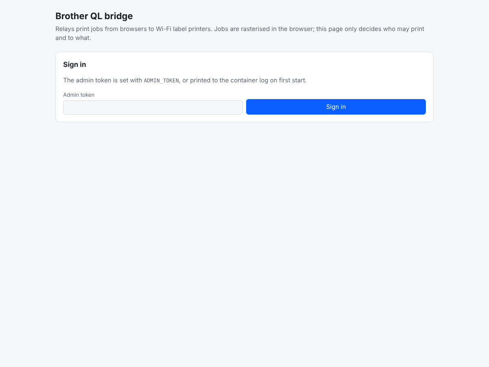
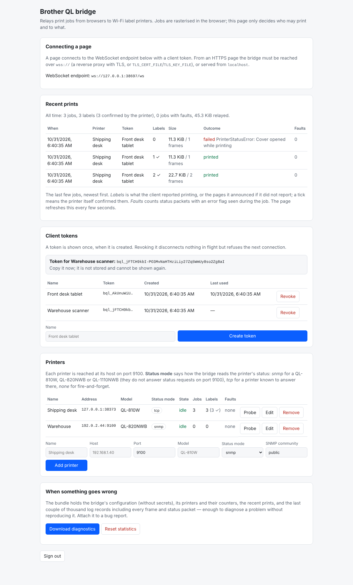
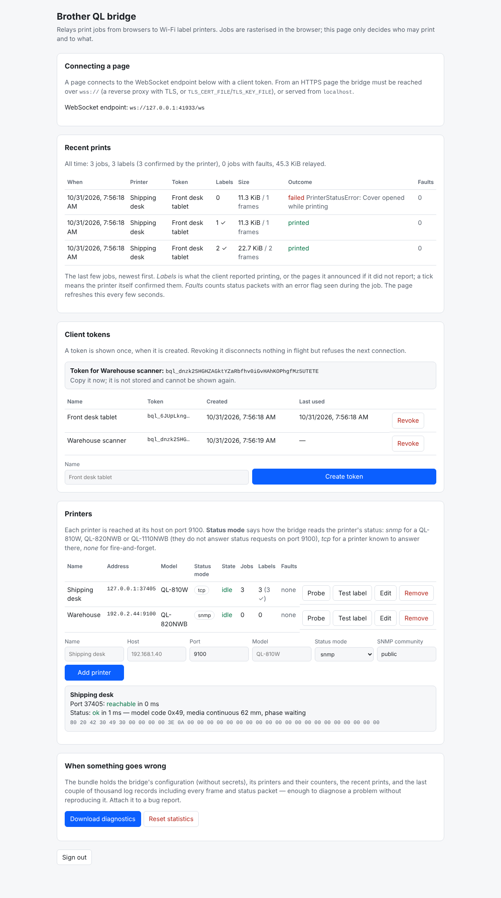
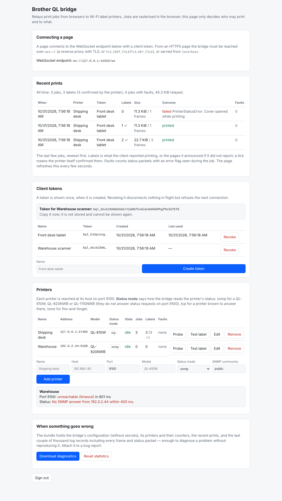
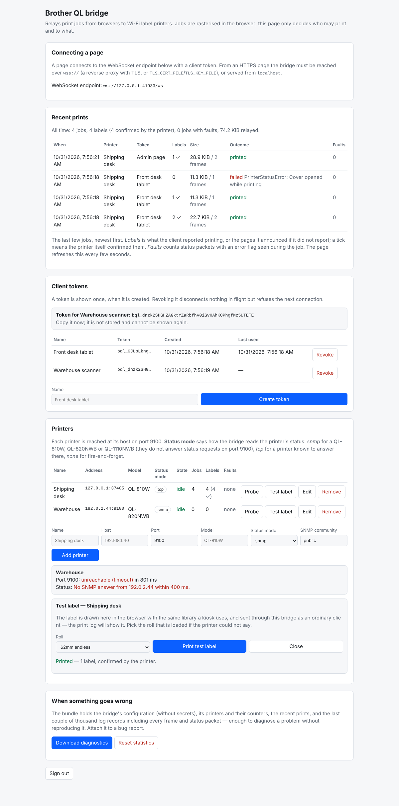

# brother-ql-bridge

A small WebSocket-to-TCP relay that lets a web page print to a **Wi-Fi** Brother
QL label printer, which a browser cannot reach on its own. It is the companion
to [`@vrwarp/brother-ql-webusb`](../README.md) and its `BridgeTransport`.

A browser can open a USB device (WebUSB) and a WebSocket, but not a raw TCP
connection — and a networked Brother QL listens for jobs on raw TCP port 9100.
The bridge closes that one gap and nothing more:

- it holds the list of printers and the bearer tokens that may use them;
- for one authenticated WebSocket it opens one TCP connection to one printer
  and pipes bytes both ways;
- it reads a printer's **status** over SNMP (or port 9100, per printer) and
  relays the 32 byte block, because most network QL models never answer the
  `ESC i S` status request on 9100.

**It does not rasterise.** Every byte the printer receives is produced in the
browser by the library. The bridge forwards opaque frames and never interprets
a job. If the bridge is compromised it can drop or misroute jobs, but it holds
no imaging code and no printer driver.

## Run it

```bash
docker run -d --name ql-bridge \
  -p 8080:8080 \
  -v ql-bridge-data:/data \
  -e ADMIN_TOKEN=choose-a-long-random-string \
  <your-dockerhub-namespace>/brother-ql-bridge:latest
```

Then open `http://localhost:8080/` and sign in with the admin token. Add your
printers, create a client token, and paste that token into the page that will
print. The printers must be reachable from wherever the container runs — the
bridge connects to them, so it belongs on the same network as the printers.

Without a Docker image to hand you can run it from source:

```bash
npm ci
npm run build
ADMIN_TOKEN=... DATA_DIR=./data node dist/index.js
```

## The admin interface

Served at `/`, it does two things:

- **Client tokens.** Create a token (shown once — copy it then), or revoke one.
  A token is what a page presents to connect; revoking it refuses the next
  connection.
- **Printers.** Add a printer by name, host and port (9100 by default), with a
  **status mode**:
  - `snmp` — read status over SNMP, OID `1.3.6.1.4.1.2435.3.3.9.1.6.1.0`, which
    Brother documents as the network equivalent of `ESC i S`. The right choice
    for a QL-810W, QL-820NWB or QL-1110NWB.
  - `tcp` — write `ESC i S` to port 9100 and read the reply. Only for a printer
    known to answer there.
  - `none` — no status; jobs are fire and forget.

  **Probe** opens the printer's port and fetches a status, so you can confirm a
  printer is reachable and loaded before anyone prints to it.

  **Test label** prints one. The page draws the label in the browser with the
  same library a kiosk uses (bundled into the page at build time), reads the
  loaded roll off the printer to pick the right size, and sends it through
  this bridge as an ordinary client, so the job appears in the print log like
  any other. The bridge itself still never rasterises anything. The page uses
  a short-lived token the admin API mints for it (`POST
  /api/admin/tokens/ephemeral`, ten minutes, kept in memory only, never
  listed), so no permanent client token is needed to press the button.

## A walk through the admin page

Sign in with the admin token. A wrong token is refused in place.



The dashboard shows the WebSocket endpoint a page connects to, the client
tokens, and the printers. Creating a token shows it once, in full; the list
keeps only its name and prefix afterwards.



Register a printer by name, host, port and status mode. **Probe** opens its
port and fetches a status — here a QL-810W answering with 62 mm continuous
tape loaded, with the raw packet underneath for the client-side decoder.



A printer that cannot be reached says so, for both the port and the status
path, so a wrong address is caught before anyone prints to it.



**Test label** prints one through the bridge from the page itself, picking the
roll the printer reports, and the print log below records it.



The page follows the system colour scheme and fits a phone. The screenshots
are regenerated with `node scripts/screenshots.mjs` after `npm run build`
(needs Playwright on the path).

## A simulated printer, for debugging

The dashboard's **Simulated printer** card switches on a printer that does not
exist. While it is enabled, every client sees **Simulated QL-810W** in the
list beside the real printers, can open it, print to it and read its status,
and the bridge logs its jobs like any other's. Nothing on the wire differs:
the session relays the client's frames into an in-process stand-in instead of
a TCP socket, and reads its 32 byte status block instead of asking SNMP. The
stand-in parses the raster stream the way the printer does — the `ESC i …`
settings, the lines, the print commands — counts the pages, and keeps the last
label as a bitmap, which the card draws (rotate it, download it as PNG) so
you can see what a page actually sent.

The switches are the faults a real printer has on a busy day, and how a page
recovers from each is what the simulator is for:

- **Switched on** — off, the printer refuses connections and status reads
  time out, as an unplugged one does. **Restart** switches it off for five
  seconds and back on, with any job in flight dropped mid-way.
- **Cover open** and **Out of media** — the status block carries the error
  bits (`Cover opened`, `No media`) and nothing prints until cleared.
- **Quiet on SNMP** — the data path works but every status read times out,
  as a printer whose radio has dozed does.
- **Resets every connection** — port 9100 accepts and hangs up at once.
- **Refuses a job rasterised for another roll** — the job's `ESC i z` is
  checked against the loaded roll and a mismatch raises the `Replace media`
  error a real printer raises, until the roll is changed. A kiosk set up for
  the wrong label size is the likeliest misconfiguration there is; leave this
  on.
- **Roll loaded** — the common QL rolls, or a custom size through the API.
- **Printing time per page** governs how long the status reports the printing
  phase; **delay before each frame** makes a slow printer.

The card also shows the status block as a poll would see it, counters
(connections, frames, bytes, jobs, pages printed, status reads) and the last
job: how many pages, how many printed, how many raster lines, what media it
was rasterised for, and how it ended. **Test label** on the simulated
printer's row works like on any printer, which is the quickest way to see the
whole path — library, bridge, printer — on a machine with nothing plugged in.

Whether the simulator is enabled is kept in `bridge.json`, so it survives a
restart; its faults and counters do not, as a real printer's do not survive
its power. `SIMULATED_PRINTER=true` in the environment enables it at every
start, for a debugging deployment or a test harness. The printers API refuses
to edit or remove it (`400`); the card's own API is `GET`/`PUT
/api/admin/simulator` (`enabled`, `power`, `faults`, `media`, `printMs`,
`frameDelayMs`, `checkMedia`), `POST /api/admin/simulator/restart` (`ms`),
`POST /api/admin/simulator/reset`, and `GET /api/admin/simulator/label` for
the bitmap. **Disable it before anyone prints for real** — a client that
picks it prints nothing.

## The print log and statistics

The dashboard's **Recent prints** card lists the last few jobs (five by
default, `RECENT_JOBS`), newest first: when, which printer, which client (the
token's name and, if the client gave one, its own — a kiosk's name), how many
labels, how big, how it ended, and whether the printer reported a fault while
it ran. The printers table carries all-time counters per printer — jobs,
labels (with how many the printer itself confirmed) and jobs with faults — and
the card's first line sums them.

The bridge never looks inside a job, so it learns what a burst of frames was
from the client: the library announces each job (page count and label) before
writing it and reports afterwards how it ended and how it knew. The bridge
counts bytes and frames itself and notes every status packet that passes
through, which is where faults show up whichever way they travelled. A client
that announces nothing still gets a record, ending when it closes the printer
or its frames go quiet (`JOB_IDLE_MS`), with the page count unknown.

**Reset statistics** forgets the counters and the list.

## When something goes wrong

Every log line carries the connection's short session id and, once a printer
is open, its name, so one connection's story can be pulled out of a transcript
by id. Frames, acknowledgements and relayed bytes are logged at `debug`, with
the hex of every status packet. The in-memory buffer keeps every level
(`LOG_BUFFER` records, 2000 by default) regardless of what stdout gets
(`LOG_LEVEL`, `info` by default), so the detail is there after the fact
without anyone having to turn verbose logging on and reproduce the problem.

**Download diagnostics** on the dashboard (or `GET /api/admin/diagnostics`
with the admin token) saves one JSON file holding the bridge's version and
uptime, its configuration with secrets left out, the printers and their
counters, the recent prints, the token names, and that log buffer. Attach it
to a bug report; it is what a maintainer needs to see what happened.

## Configuration

All via environment variables; the defaults suit the container.

| Variable | Default | Meaning |
| --- | --- | --- |
| `ADMIN_TOKEN` | generated | The admin interface's bearer token. When unset, one is generated on first start and printed to the log once; set this to choose your own. |
| `PORT` | `8080` | TCP port to listen on. |
| `HOST` | `0.0.0.0` | Address to bind. |
| `DATA_DIR` | `/data` | Where `bridge.json` (tokens and printers) is kept. Mount a volume here. |
| `ALLOWED_ORIGINS` | `*` | Comma-separated browser origins allowed to connect, or `*` for any. The bridge's own origin — the admin page — is always allowed. The bearer token is the real access control; this is defence in depth. |
| `TLS_CERT_FILE`, `TLS_KEY_FILE` | — | PEM files. Set both to serve HTTPS and `wss://` directly instead of behind a TLS proxy. |
| `AUTH_TIMEOUT_MS` | `10000` | How long a connection may stay unauthenticated. |
| `CONNECT_TIMEOUT_MS` | `5000` | How long to wait for a printer's port 9100 to accept. |
| `SNMP_TIMEOUT_MS` | `2000` | How long to wait for an SNMP answer. |
| `SNMP_RETRANSMIT_MS` | `700` | Resend an unanswered SNMP request this often within the timeout; `0` sends it once. A lost datagram is how a status read usually fails on a poor Wi-Fi link. |
| `WS_PING_MS` | `25000` | Ping every client this often; `0` disables. Keeps an idle connection alive through a reverse proxy's idle timeout (Synology's is 60 s). A client that answers neither of two pings in a row is dropped. |
| `LOG_LEVEL` | `info` | Lowest level written to stdout (`debug`, `info`, `warn`, `error`). The diagnostics buffer keeps every level. |
| `LOG_BUFFER` | `2000` | Log records kept in memory for the diagnostics bundle. |
| `RECENT_JOBS` | `5` | Finished print jobs kept and shown on the dashboard. |
| `JOB_IDLE_MS` | `3000` | Quiet time after which a job the client never reported on counts as sent. |
| `SIMULATED_PRINTER` | `false` | Enable the simulated printer at start-up. The admin page can switch it either way at any time. |

## Behind a reverse proxy

A reverse proxy that terminates TLS in front of the bridge — Synology's,
nginx, Caddy — must pass the WebSocket upgrade through (`Upgrade` and
`Connection` headers; Synology's reverse proxy has a *WebSocket* custom header
preset for this). Most also cut a connection that carries nothing for a while:
nginx's `proxy_read_timeout`, and so Synology's, defaults to 60 seconds, which
an idle kiosk's connection would hit once a minute. The bridge pings every
client every `WS_PING_MS` (25 s) so that it does not, and a kiosk whose pongs
stop coming is dropped after two misses. Raise the proxy's timeout as well if
you can; a connection kept open by pings alone is fine, but a longer timeout
costs nothing.

## Security notes

- **Tokens are hashed.** Only the SHA-256 of each token is stored, with the
  first few characters kept in clear so tokens can be told apart in the list. A
  token is shown in full exactly once, when created.
- **Serve it over TLS.** A browser on an HTTPS page can only open a `wss://`
  WebSocket, and the admin token travels in an `Authorization` header. Put the
  bridge behind a TLS-terminating reverse proxy, or set `TLS_CERT_FILE` and
  `TLS_KEY_FILE`. (A page served from `localhost` may use `ws://`.)
- **It runs as a non-root user** (uid 1000) and writes only to `/data`.
- **One client per printer.** The bridge locks a printer to the one connection
  that opened it, so two pages cannot interleave jobs on one device.

## Using it from the library

```ts
import {
  BrotherQLPrinter,
  BridgeTransport,
  listBridgePrinters,
  enableBrowserImages,
} from '@vrwarp/brother-ql-webusb';

const url = 'wss://bridge.example/ws';
const token = '…a client token from the admin page…';

// Show the user the printers the bridge offers.
const printers = await listBridgePrinters({ url, token });

// Open one and print to it exactly as over USB.
const transport = new BridgeTransport({ url, token, printerId: printers[0].id });
const printer = new BrotherQLPrinter(transport, { model: printers[0].model ?? 'QL-810W' });
enableBrowserImages(printer);

await printer.open();
await printer.print(canvas, { label: '62' });
await printer.close();
```

See the [library README](../README.md#printing-over-wi-fi-the-bridge) for how
completion is reported over the network, which differs from USB.

## Protocol

Control messages are JSON text frames; printer data is binary frames. The shape
is defined in `src/protocol.ts` here and mirrored in the library's
`src/bridge/protocol.ts`; `BRIDGE_PROTOCOL_VERSION` (currently 2) is sent in the
`hello` frame and checked by the client. A session is: `hello` → `auth` →
`auth-ok` → `open` → `opened` → `job` → binary frames each answered by `ack`,
with `status` fetching a status block → `job-done`, until `close` or the
socket drops. `job` and `job-done` carry the page count and the outcome for
the print log and get no reply.

## Development

```bash
npm ci
npm run typecheck
npm test          # ~175 tests: SNMP codec, store, print log, HTTP admin API, the
                  # relay end to end, the relay under a slow, lossy printer link,
                  # and the simulated printer
npm run build
```
